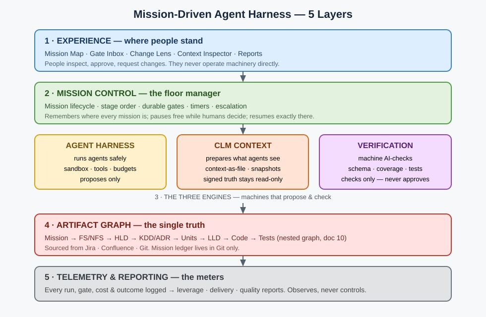

# Production-Ready Agent Harness — Research & Blueprint

> **This is an original, mission-driven engineering lifecycle — not an implementation
> of any vendor's AI lifecycle framework.** See §2.1 for how it differs.

> **Status:** Research / proposal — NOT yet an implementation commitment
> **Date:** 2026-10-17 · **Repo state at writing:** empty (`README.md` only) — greenfield
> **Working name:** Mission Factory (it is *not* a code factory — see §1)

---

## 1. Reframing the problem

A "code factory" optimises one step: `spec → code`. What you described is a
**mission-to-value operating system**:

```
Mission / Problem Statement
  → FS + NFS            (brainstorm w/ Product Owner + Lead Architect)
  → HLD                 (brainstorm w/ Architect + Teams)
  → KDDs recorded       → signed off (stakeholders)
  → ADRs                → signed off (engineers / architect)
  → Decomposition into incremental-value units
  → LLDs + low-level ADRs (per unit)
  → Code changes / creation
  → Verification → Release → Operations → Retrospective / learning
```

Every arrow is (a) an **agent** with a typed input/output contract,
(b) an **AI-check** (machine-verifiable), (c) a **human gate** (accountable
sign-off), and (d) an **artifact** that a human can read, navigate, diff and —
critically — **author by hand if AI disappears tomorrow**.

Design principles that follow from your requirements:

| # | Principle | Consequence |
|---|---|---|
| P1 | **Artifacts > conversations.** Chats are ephemeral; the repo is the system of record. | Everything of value lands as versioned Markdown/YAML in Git. No hidden state in a vendor DB. |
| P2 | **Agents propose, humans dispose.** | No agent may cross a gate. Agents produce *proposals + evidence*; gates are signed by named humans. |
| P3 | **Every claim is traceable.** | Mission → FS/NFS → HLD → KDD/ADR → Unit → LLD → Code → Test → Release is one linked graph. Orphans fail CI. |
| P4 | **AI is an accelerator, never a dependency.** | The same workflow must run 100% manually. AI-off is a tested mode, not a hope. |
| P5 | **Context is a product, not a prompt.** | Context is compiled, versioned, diffed, budgeted and audited per agent run (the CLM layer, §6). |
| P6 | **Measure leverage, delivery and quality separately.** | Vanity metrics (LOC, PR count) are explicitly banned as success measures (§9). |

---

## 2. What the research says

### 2.1 How this approach differs

This approach is often confused with vendor AI-lifecycle / "AI-assisted SDLC"
frameworks and with spec-to-code coding tools. It is neither. The differences
are structural, not cosmetic:

| Dimension | Conventional AI-assisted lifecycle / coding-agent tools | **This approach** |
|---|---|---|
| Starting point | A feature request, ticket or prompt handed to a coding agent | A **mission / problem statement** with value hypothesis, scope/non-goals and success metrics — the problem is negotiated before any solution exists |
| Primary unit of work | The task / story / code change | The **mission**, decomposed only after sign-off into *incremental-value units*, each independently demoable |
| Artifact chain | Requirements → maybe a design note → code; rationale lives in chat/tickets | A signed, traceable chain: **Mission → FS/NFS → HLD → KDD (stakeholder-signed) → ADR (engineer-signed) → Units → LLD + low-level ADRs → Code → Verification → Release**, as a navigable graph |
| Decisions | Made in meetings/chat, recorded optionally | **KDDs and ADRs are first-class gated artifacts** with their own sign-off authorities; immutable once signed, superseded never edited |
| Agent model | One general coding agent steered by rules/prompts inside an IDE | A **registry of contracted specialist agents** (doc 02): typed I/O, allowed/forbidden tools, budgets, eval suites, version promotion — the harness, not the chat, is the platform |
| Human control | "Human reviews the PR" or approves a plan in chat | **Separation of AI-checks vs human gates** (G0–G10, doc 03): machines verify form/completeness; named accountable humans sign scope (PO), architecture (architect), key decisions (stakeholders), ADRs (engineers), release (owner) — hash-pinned, dual-control at high risk, approver ≠ proposer |
| Context | Prompt + steering/rule files + conversation history in one vendor tool | An **emulated Context Language Model** (doc 05): context-as-a-file the model edits, partitioned into read-only signed truth vs editable working context, snapshotted and inspectable per run — model- and vendor-neutral |
| Where work lives | Inside the AI tool / IDE; export is an afterthought | **Jira + Confluence + Git** as systems of record plus our own UI (Mission Map, Gate Inbox, Change Lens, Context Inspector, doc 09); mission ledger (state/gates/audit/links) lives in Git only — no duplicated artifact content |
| If AI disappears | Workflow stops; knowledge was in chats/prompts | **AI-off is a designed, drilled mode**: every agent has a human playbook, artifacts validate identically by hand, state is readable files (doc 08) |
| Success measurement | Code volume, PRs, "AI adoption" | **Leverage + delivery + quality reported together** (doc 07): gate first-pass rate, rework, cost per accepted artifact, DORA delivery, escaped defects — vanity metrics banned as headlines |
| Brainstorming | Agent asks clarifying questions in chat | Structured **collaborative elaboration sessions** with defined participants per level (PO + Lead Architect for FS/NFS; Architect + teams for HLD), whose outcomes are written into signed artifacts, not left in transcripts |

Naming follows from this: phases here are **Mission Elaboration**
(FS/NFS, HLD, KDD, ADR) and **Mission Construction** (decomposition, LLD,
build, verify, release) — organised around a mission's value, not around a
coding tool's workflow stages.

### 2.2 The harness is the product
Recent harness-engineering literature converges on the same component list.
A 2026 formalisation of "AI Harness Engineering" names eleven
responsibilities: *task specification, context selection, tool access,
project memory, task state, observability, failure attribution,
verification, permissions, entropy auditing, intervention recording*
([arXiv 2605.13357](https://arxiv.org/abs/2605.13357)).
Production-readiness checklists reduce to six falsifiable capabilities:
**durable execution, state recovery, approval gates, permissioned tool
access, an eval harness, observability hooks**
([visione-edge](https://visione-edge.com/blog/ai-agent-framework-production-ready)).

Practical implications:
- **Durable execution is non-negotiable.** LangGraph checkpoints preserve
  *data*, not *execution*; a crashed run needs an orchestration layer to
  resume. Temporal-style durable workflows make human waits free (signals,
  no held process) and resume exactly at the gate
  ([Temporal](https://temporal.io/blog/temporal-langgraph-plugin-durable-execution)).
  A gate may wait an hour or a month — the harness must cost ~0 while waiting.
- **HITL must be a protocol primitive, not a UI afterthought:** the harness
  emits a structured *pending-action* (Approve / Reject / Request Changes /
  Escalate) and pauses durable state until a decision arrives
  ([Medium](https://medium.com/data-science-collective/the-harness-is-the-product-how-agents-are-actually-built-in-2026-4b751480f60c)).
- **Autonomy must be tiered by reversibility & blast radius**, not by
  confidence alone: reversible + low-blast-radius may auto-run; irreversible
  actions always gate
  ([digitalapplied](https://www.digitalapplied.com/blog/human-in-the-loop-escalation-design-ai-agents-2026)).

### 2.3 CLM — two meanings, and we need to pick (Question Q1)
1. **Context Language Models (Meta/UW/MIT, Sep 2026):** the model *natively
   manages its own context* by treating **context as an editable file**; edits
   sync into the live context for the next turn. Reported: +11.4% accuracy
   with −21.5% FLOPs on BrowseComp-Plus vs. summarisation baselines, and the
   pattern "naturally extends to multi-agent systems where multiple agent
   contexts coexist as files"
   ([GitHub](https://github.com/facebookresearch/context-language-models),
   [arXiv 2609.37725](https://arxiv.org/abs/2609.37725)).
2. **Context Layer / Context Language Model (enterprise usage):** your own
   governed system that *compiles* the right context (mission, artifacts,
   decisions, code, standards) for each agent run.

**Our recommendation:** implement (2) now, architected so (1) can plug in
later. I.e. contexts are **real, versioned files in the repo** (`context/…`),
each agent run gets a *compiled context bundle* with a manifest (what was
included, why, token budget, source hashes), and every context mutation is a
diff that humans can review. This gives CLM benefits (inspectable,
self-updatable context) without betting the platform on a research model.
Anthropic's context-engineering guidance points the same way: structured
note-taking / persistent memory files pulled back into context beat
ever-growing transcripts
([Anthropic](https://www.anthropic.com/engineering/effective-context-engineering-for-ai-agents)).

### 2.4 Decisions are first-class artifacts (KDD/ADR)
Spec-driven development works when ADRs live **in the repo, immutable once
accepted, superseded — never edited — and linked decision → concern →
stakeholder → code**; that linkage is the traceability chain most SDD tools
omit ([Architecture & Governance](https://www.architectureandgovernance.com/applications-technology/spec-driven-development-is-better-with-core-architecture/),
[ADR practice](https://topictrick.com/blog/architecture-decision-records-adr)).
We extend this: **KDDs** (Key Design Decisions — business/product-level,
stakeholder-signed) sit above **ADRs** (engineering-level,
architect/engineer-signed), and both are nodes in the artifact graph, so a
code diff can be explained by walking `code → LLD → ADR → KDD → HLD → FS → mission`.

### 2.5 Measurement: DORA + SPACE + agent-evals, or you will fool yourself
Evidence is blunt: AI raises individual output (+98% PRs merged per dev in
one 10k-dev study) while PR review time (+91%), PR size (+154%) and bugs
rise and organisational delivery stays flat — the "AI productivity paradox"
([Faros/DORA 2025](https://www.faros.ai/blog/key-takeaways-from-the-dora-report-2025)).
DORA's own 2024 data linked +25% AI adoption to −7.2% delivery stability
([Augment](https://www.augmentcode.com/guides/why-ai-agent-metrics-lie)).
So reporting must combine:
- **DORA** (delivery: lead time, deploy frequency, change-failure rate, recovery),
- **SPACE/DX** (human: satisfaction, flow, review burden),
- **Agent evals** (task completion, plan adherence, tool correctness,
  step efficiency, cost per successful task)
  ([Confident AI](https://www.confident-ai.com/blog/llm-agent-evaluation-complete-guide),
  [Anthropic evals](https://www.anthropic.com/engineering/demystifying-evals-for-ai-agents)).
See §9 for the concrete metric definitions.

---

## 3. Reference architecture



```
┌────────────────────────────────────────────────────────────────────┐
│  EXPERIENCE LAYER  (human-first, AI-optional)                      │
│  Mission Console · Artifact Navigator · Gate Inbox · Reports       │
│  (renders the repo; works read/write with zero AI)                 │
├────────────────────────────────────────────────────────────────────┤
│  MISSION CONTROL  (durable workflow / state machine)               │
│  Mission lifecycle · Stage graph · Gates · Timers · Escalations    │
│  Temporal / durable-exec   ·   state = files in Git + event log    │
├──────────────┬──────────────────────┬──────────────────────────────┤
│ AGENT        │  CLM CONTEXT SYSTEM  │  VERIFICATION & POLICY       │
│ HARNESS      │  Context compiler    │  AI-checks · Schema lint     │
│ Registry     │  Context-as-files    │  Traceability checker        │
│ Runner       │  Manifests, budgets, │  Policy engine (OPA-style)   │
│ Sandbox      │  snapshots, diffs    │  Eval harness (CI gates)     │
│ Tool gateway │  Memory scopes       │  Security / secrets scan     │
├──────────────┴──────────────────────┴──────────────────────────────┤
│  ARTIFACT & UNDERSTANDING GRAPH  (source of truth)                 │
│  missions/… FS/NFS · HLD · KDD · ADR · units · LLD · code · tests  │
│  Git + front-matter IDs/links · generated indexes & trace matrix   │
├────────────────────────────────────────────────────────────────────┤
│  TELEMETRY & REPORTING                                             │
│  OTel traces per run · audit/event log · cost ledger               │
│  Leverage / Delivery / Quality marts → dashboards (§9)             │
└────────────────────────────────────────────────────────────────────┘
        Models (any vendor / local) · Tools via MCP · CI/CD · IdP/SSO
```

**Key choice:** the *system of record is the repository* (Markdown + YAML
front-matter + generated indexes). Databases/caches may exist for speed,
but they are **rebuildable projections** of the repo. That single decision
buys auditability, offline work, vendor independence and human takeover.

---

## 4. Every agent: typed I/O contract + two kinds of checks

### 4.1 The universal agent contract
No agent exists without a registry entry like this (machine-validated):

```yaml
agent: hld-designer            # id, versioned (semver)
version: 1.3.0
purpose: "Draft HLD from signed-off FS/NFS"
inputs:                        # typed, required, with source-of-truth paths
  - { name: mission,   type: Mission,        ref: missions/{id}/mission.md }
  - { name: fs_nfs,    type: FS/NFS,         ref: missions/{id}/fs-nfs.md, gate: G1-signed }
  - { name: standards, type: ContextBundle,  ref: context/compiled/hld@*.yaml }
outputs:                       # artifacts written, schemas they must satisfy
  - { name: hld,       type: HLD,            path: missions/{id}/hld.md, schema: schemas/hld.json }
  - { name: open_questions, type: Question[], path: missions/{id}/questions/hld.yaml }
tools_allowed: [read_repo, read_context, diagram_render]   # least privilege
tools_forbidden: [write_code, deploy, external_send]
ai_checks:                     # must ALL pass before human sees it (§4.2)
  - schema_valid; traceability_complete; nfs_coverage_matrix; diagram_renders
human_gate: G2                 # gate id from §5; agent can NEVER self-approve
autonomy: L1                   # L0 manual · L1 draft-only · L2 auto-reversible · L3 auto-gated-scope
budget: { max_tokens: 120k, max_cost_usd: 4, max_wall_min: 30 }
eval_suite: evals/hld-designer/   # golden missions + rubric; CI blocks regressions
fallback: human_playbook: playbooks/hld-manual.md   # AI-off procedure (§8)
telemetry: [run_id, model, tokens, cost, context_manifest_hash, check_results]
```

### 4.2 AI-checks vs Human gates — never conflate them
| | AI-check (machine) | Human gate (accountable) |
|---|---|---|
| Question | "Is it well-formed, complete, consistent?" | "Is it *right*? Do we accept the risk/cost?" |
| Examples | schema, links resolve, every FS has HLD section, every NFS has a design response, no orphan units, tests exist & pass, ADR conflicts detected | scope worth doing, trade-off accepted, budget approved, production risk accepted |
| On fail | Agent auto-repairs (bounded retries) or escalates with a defect report | Request Changes (with comments as new context) / Reject / Escalate |
| Recorded as | check-run artifact attached to the proposal | signed gate record: who, when, decision, rationale, dissent |

### 4.3 Persona-agents & skills (not a flat agent list)

The system does NOT run 13 disconnected specialist agents. It runs **6
persona-agents** — persistent identities mirroring human roles (Product,
Architect, Engineering, Quality, Delivery, Knowledge), each with its own
context partition and permission ceiling — applying **many contracted
skills case-by-case** from **fixed pre-approved templates per mission
type** (no per-mission composition; deviations need human approval); e.g.
a standard feature template uses fs-elaboration →
hld-design → adr-drafting → value-slicing → implementation → verification,
while a low-risk bugfix uses defect-analysis → code-fix → verification.
Full registry: doc 02. Summary of the skill chain:

| # | Agent | Consumes → Produces | Key AI-checks | Human gate (sign-off) |
|---|---|---|---|---|
| A0 | **Mission Intake** | raw ask → `mission.md` (problem, value hypothesis, scope/non-goals, success metrics) | completeness lint, duplicate-mission search | **G0** PO accepts mission |
| A1 | **FS/NFS Elaborator** | mission + repo/context → FS, NFS (perf, security, compliance, operability…), open questions | every FS testable (Given/When/Then or measurable), NFS quantified not adjectival | **G1** PO + Lead Architect |
| A2 | **HLD Designer** | signed FS/NFS → HLD (components, boundaries, data, integrations, failure modes) + diagrams | FS/NFS coverage matrix 100%, diagram renders, capacity assumptions stated | **G2** Architect + team leads |
| A3 | **KDD Recorder** | brainstorm transcript/decisions → KDD records (context, options, trade-offs, consequences) | options ≥2 or "no alternative" justified, linked to FS/HLD sections | **G3** Stakeholders |
| A4 | **ADR Drafter** | HLD+KDDs → ADRs (one decision each) | ADR schema, conflicts with existing accepted ADRs flagged, supersedure links | **G4** Architect + engineers |
| A5 | **Decomposer** | signed HLD/ADRs → units of *incremental value* (each independently demoable/shippable), dependency graph, per-unit acceptance criteria | every FS covered by ≥1 unit, no unit without value statement, DAG acyclic, unit ≤ size budget | **G5** PO + Architect (plan + verification command approved here) |
| A6 | **LLD Designer** (per unit) | unit + HLD → LLD (APIs, schemas, sequences, error handling) + low-level ADRs | contract tests derivable, LLD↔HLD conformance, low-level ADR conflicts | **G6** Unit's engineers (+ architect if ADR) |
| A7 | **Builder** (per unit) | LLD → code + tests (in sandbox, on branch) | build, unit/contract tests, lint, SAST, coverage Δ, no secrets, PR size budget | **G7** Code review (human, CODEOWNERS) — agent never merges |
| A8 | **Verifier** | branch → verification report (runs the G5-approved verification command, e2e, NFS evidence e.g. load/security tests) | all deterministic checks green; flaky-test quarantine; evidence attached, not asserted | part of G7/G8 evidence |
| A9 | **Release Agent** | verified units → release plan, rollout/rollback, comms draft | env parity, rollback tested, feature-flag wiring | **G8** Release owner / on-call (irreversible ⇒ always human) |
| A10 | **Ops Watcher** | telemetry → SLO/error-budget report, incident drafts | anomaly evidence linked to release & units | human incident command (AI assists only) |
| A11 | **Review Explainer** | any artifact diff → *change narrative*: what changed, why, impact, risk, review checklist (§7) | narrative references only real diff hunks/IDs | reviewer uses it; it gates nothing |
| A12 | **Reporter** | event/audit/cost ledgers → leverage/delivery/quality reports (§9) | metric definitions versioned; data lineage shown | Eng. leadership reviews monthly |
| A13 | **Librarian / Context Curator** | merged artifacts, retros → context updates (standards, playbooks, learned rules) as PRs | context diff reviewed like code; stale-context detection | **G9** Context owner approves context changes |

Brainstorming (your "brainstorm with PO/architect/teams") is a *mode*, not a
separate agent: A1–A4 run **collaborative elaboration sessions** — agent asks structured
questions, humans answer, every answer is written into the artifact + audit
log in real time. The transcript is evidence; the artifact is the outcome.

---

## 5. Gate & autonomy model

- **Gate record (immutable, in repo):** `gates/G2.yaml` → decision, approver(s)
  (from IdP, not free text), timestamp, artifact hashes approved (so "what
  exactly did you sign?" is answerable), comments/dissent, expiry (a gate
  re-opens if its inputs change — hash mismatch ⇒ stale approval).
- **Dual control:** G3 (KDD), G4 (ADR), G8 (release) require **two** distinct
  humans where risk tier = high; approver ≠ proposer (the human who prompted
  the agent cannot be sole approver — separation of duties).
- **Autonomy tiers per stage** (set by policy, changeable only by PR):
  `L0` human-only · `L1` agent drafts, human does everything else ·
  `L2` agent may auto-run *reversible* steps inside an approved plan ·
  `L3` agent may proceed across low-risk stages, gates still human.
  Default: **L1 everywhere; L2 only for A8 checks and A11/A12.**
- **Risk tiering:** mission intake classifies (regulatory, data sensitivity,
  blast radius, reversibility). Tier drives gate count, dual control, eval
  strictness and whether L2+ is even permitted.

- **Auto-approval (signed off 2026-10-17, author choice):** low-risk gates may
  auto-pass — specifically stages inside an approved plan, repeat units
  matching an approved pattern, **G6 (LLD) when low-risk with no low-level
  ADR**, and routine unit checkpoints. G3/G4 (high risk) and G8 (release)
  NEVER auto-pass. Mandatory guardrails for every auto-approval: (1) all
  AI-checks green, (2) low risk tier, (3) change reversible, (4) fully
  audit-logged, (5) random human audit sampling of auto-passed gates,
  (6) one-click global auto-off switch. Any guardrail breach or check
  failure re-gates to a human automatically.

---

## 6. CLM context system (the "Context Layer")

```
context/
  sources/        # curated truth: standards, domain glossary, arch principles,
                  #   accepted ADR index, team topology, compliance rules
  mission/{id}/   # per-mission context file (CLM-style: editable, versioned)
  compiled/       # per-run bundles: bundle.yaml (manifest) + content
  snapshots/      # immutable hash of context used for every agent run
```

Rules:
1. **Compiled, not dumped.** For each run, the Context Compiler selects from
   sources + mission context + artifact graph neighbourhood, under a token
   budget, and emits a **manifest**: included items, source path+hash,
   *reason for inclusion*, exclusions. Reviewable like a PR.
2. **Context-as-file (CLM pattern).** The mission context file is a living
   document the agent may *propose edits to* (new fact learned, question
   resolved); edits land as diffs, are AI-checked (no contradiction with
   signed artifacts) and, above L1, human-approved by the Librarian (A13).
   Signed-off artifacts are **read-only context** — an agent can never
   quietly rewrite history it doesn't like.
3. **Precedence:** signed artifacts > accepted ADRs/KDDs > standards >
   mission context > retrieved code/docs > conversation. Conflicts surface
   as findings, never silent overrides.
4. **Freshness & poisoning guards:** every context item has owner + review
   date; stale items warn; externally-sourced content is quarantined until
   curated (prompt-injection defence); secrets never enter context (scanner
   on compile).
5. **Reproducibility:** run ⇒ `context_snapshot_hash` stored in telemetry.
   Re-running with the same snapshot + model + agent version must be
   *expl*ainably* similar — this is what makes evals and audits meaningful.

---

## 7. Human-readable understanding & review (your "navigable understanding")

Per mission, one entry point — `missions/{id}/README.md` (generated, but
hand-editable) — the **Mission Brief**:

- **Narrative:** problem, why now, value hypothesis, scope/non-goals (≤1 page, plain language).
- **Map:** the Semantic Artifact Graph (doc 10) — nested, expandable from
  mission down to a single FS item / decision clause / API operation, with
  tiered summaries (S0/S1/S2) and rollup health at every level. Agents query
  this graph through structured tools, not file search.
- **Change lens ("what changed at each level"):** for any revision, a
  *semantic diff* per level — e.g. "FS-07 changed ⇒ HLD §3.2, ADR-014 and
  Units U3/U5 impacted; U3 code untouched, U5 acceptance criteria stale ⚠".
  Implemented as: artifact IDs + typed links ⇒ impact analysis over the
  graph (doc 10 §5: typed-edge reverse walk → invalidates / requires-review /
  rollup / notify; propagation stops at sign-off boundaries); the Review
  Explainer (A11) writes the prose, the graph provides the facts (so the
  prose is checkable, not hallucinated).
- **Review packs:** each gate gets a generated pack: the artifact, the diff
  since last gate, AI-check evidence, open questions, risks, and a reviewer
  checklist. Reviewers review *packs*, not raw model output.
- **Traceability matrix:** auto-generated FS→Unit→Test→Release table;
  orphans/gaps fail the phase-boundary verification gate (CI), per §2.1.

---

## 8. Human takeover (AI-off mode) — a feature with tests

Guarantees:
1. **Zero hidden state.** Workflow state = `missions/{id}/state.yaml`
   (current stage, gate status, hashes) in Git; event log = append-only
   `audit.md`/JSONL in Git. Any human can read state and continue.
2. **Every agent has a human playbook** (`playbooks/…md`): inputs to gather,
   template to fill, checks to run by hand/script, gate to request. Agents
   and playbooks share the *same templates and schemas* — an artifact
   produced manually validates identically.
3. **No proprietary formats.** Markdown + YAML + Mermaid + code. Exit cost
   from any model vendor or from this platform ≈ 0.
4. **"AI-off drill" in CI / quarterly game-day:** a sample mission is driven
   two stages with agents disabled; success = gates pass with manual
   artifacts. If the drill fails, that's a P1 defect in the platform.
5. **Degraded modes:** model outage ⇒ queue & notify; budget exhausted ⇒
   missions park at gates (never auto-spend); harness down ⇒ humans work
   in Git directly, harness reconciles on recovery (state is derived).

---

## 9. Reporting: AI leverage · Delivery · Quality

All metrics computed from the event/audit/cost ledgers; definitions are
versioned (`metrics/definitions.yaml`) and every dashboard shows lineage.
**Never report a single number alone** — leverage without quality is how
teams ship the productivity paradox (§2.5).

### 9.1 AI leverage (is AI actually helping, where, at what cost?)
| Metric | Definition |
|---|---|
| Gate first-pass rate | % agent proposals passing a gate without Request-Changes (per agent/stage) — *the* core leverage signal |
| Rework ratio | human edit distance / change-request cycles per accepted artifact |
| Human touch time | reviewer/approver minutes per gate (from gate events + sampling) — leverage = same outcome, less touch time |
| Stage cycle time | median duration per stage, reported descriptively — **no manual baseline in v1 (D9)**; trend vs archived past reports once ≥2 periods exist |
| Autonomy yield | % steps completed at L2/L3 without escalation or later defect |
| Cost per accepted artifact / per shipped unit | tokens + tools + infra, from cost ledger (not per *generated* artifact) |
| Assisted vs manual cohort | outcomes of AI-on vs AI-off missions (the drill data doubles as control group) |

### 9.2 Delivery (DORA-aligned)
Change lead time (commit→prod), deployment frequency, change-failure rate,
failed-deployment recovery time + mission-level: mission lead time
(intake→value in prod), unit throughput, gate wait time (where do missions
actually wait — usually humans, and that's fine, but make it visible).

### 9.
...[truncated 6150 chars]