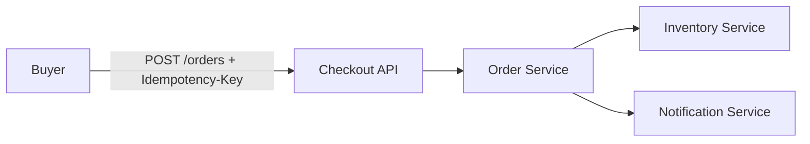

# HLD@v2 — High-level design

## Purpose
Component-level design covering 100% of FS-NFS@v3, with the failure modes and
capacity assumptions G2 signs.

## Summary (S1)
Four components: Checkout API (edge, latency budget), Inventory Service
(partial fulfilment, remainder), Order Service (submission, idempotency,
lifecycle, audit) and Notification Service (confirmations). Order Service is
constrained by ADR-014. Coverage matrix below is generated from the declared
component links and is the G2 coverage proof.

## Scope & Non-scope
Covers the mission's FS/NFS. Non-goals: payment auth internals, seller portal.

## Context diagram

## Components & boundaries
### C-1 — Checkout API
statement: Edge API; auth, payload validation, latency budget for checkout.
covers: [NFS-007]

### C-2 — Inventory Service
statement: Line-level stock, partial fulfilment and remainder handling.
covers: [FS-015, FS-017, FS-018, FS-019]

### C-3 — Order Service
statement: Owns order submission, idempotency dedup and the order lifecycle record.
decided_by: [ADR-014]
covers: [FS-014, FS-016, FS-020, NFS-011, NFS-013]

### C-4 — Notification Service
statement: Confirmation and status notifications; must obey dedup semantics.
covers: [FS-021, FS-022]

## Data model sketch
orders, order_lines, shipments, idempotency_keys (key → order_id, 24h TTL),
order_events (append-only, 90d retention).

## Integrations
Payment auth (existing), seller fulfilment feeds (existing), notification
provider (existing).

## Failure modes
Dedup store down → submission fails fast (NFS-011 budget), never
duplicate-create. Inventory split-brain → order stays partially-fulfilled,
reconciliation job re-derives state.

## Capacity assumptions
2k rps peak submission; idempotency_keys ≈ 3× order volume with 24h TTL.

## FS/NFS coverage matrix
| Component | Covers |
|---|---|
| C-1 | NFS-007 |
| C-2 | FS-015, FS-017, FS-018, FS-019 |
| C-3 | FS-014, FS-016, FS-020, NFS-011, NFS-013 |
| C-4 | FS-021, FS-022 |

## Decisions & Rationale
ADR-014 constrains C-3 (idempotency mechanism); KDD-002 constrains C-2's
partial-fulfilment policy.

## Open Questions
(none open.)

## Risks & Assumptions
Capacity assumptions above are the G2-risk register entry.

## Verification
AI-checks at G2: coverage_100pct over the matrix, failure modes present,
capacity assumptions present.

## Change Log
| version | date | author | reason |
|---|---|---|---|
| 2 | 2026-10-18 | human:Asiant | signed fixture set (v1 draft after G1) |
